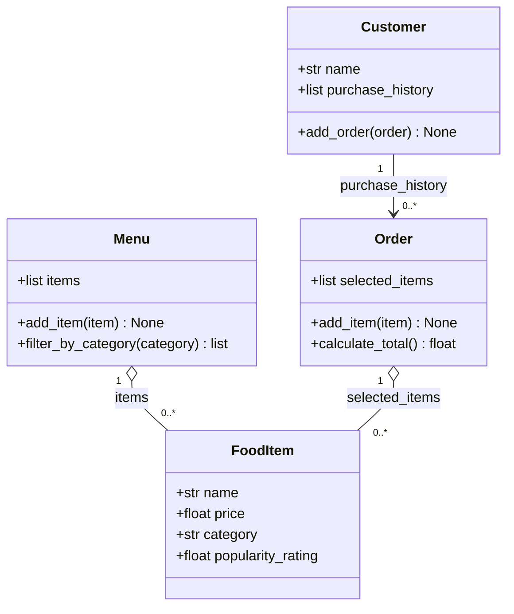

# ByteBites Class Diagram (Final)

## Classes and Responsibilities

| Class | Attributes | Methods | Responsibility |
|---|---|---|---|
| **Customer** | `name`, `purchase_history` (list of `Order`) | `add_order(order)` | Stores who the customer is and their past orders. |
| **FoodItem** | `name`, `price`, `category`, `popularity_rating` | none (data only) | Holds the data for one item we sell, e.g. "Spicy Burger" or "Large Soda". |
| **Menu** | `items` (list of `FoodItem`) | `add_item(item)`, `filter_by_category(category)` | Holds the full collection of items and filters it by category such as "Drinks" or "Desserts". |
| **Order** | `selected_items` (list of `FoodItem`) | `add_item(item)`, `calculate_total()` | Groups the picked items into one transaction and computes the total cost. |

## Relationships

- **Customer → Order (1 to 0..\*)**: a customer's purchase history is a list of their orders. A new customer has none.
- **Menu ◇— FoodItem (1 to 0..\*)**: the menu holds food items. `FoodItem` is a standalone object, so this is aggregation.
- **Order ◇— FoodItem (1 to 0..\*)**: an order holds the items the user picked. The same `FoodItem` can be on the menu and in many orders.

## Assumptions

1. **Verification is undefined.** The spec says customer names and purchase history are tracked "so the system can verify they are real users," but it gives no verification rule. The design therefore has no verification method. The two attributes are stored so a rule can be added later if one is defined.
2. **Purchase history is a list of `Order` objects.** This reuses the four given classes instead of adding a "Purchase" class.
3. **`Customer.add_order`, `Menu.add_item` and `Order.add_item` are minimal supporting methods.** The spec implies them (history must be recorded, the menu must be filled, and a user picks items) but doesn't name them.
4. **No quantities.** Adding the same item twice puts it in the list twice. The spec doesn't mention quantities.
5. **`category` is a plain string and `popularity_rating` is a number.** The spec gives no list of categories or rating scale.
6. **`Order` stores no price of its own.** `calculate_total()` adds up each item's `price`.
7. **Scope is limited to the four classes.** There is no authentication, database layer, or any other feature outside the spec.
