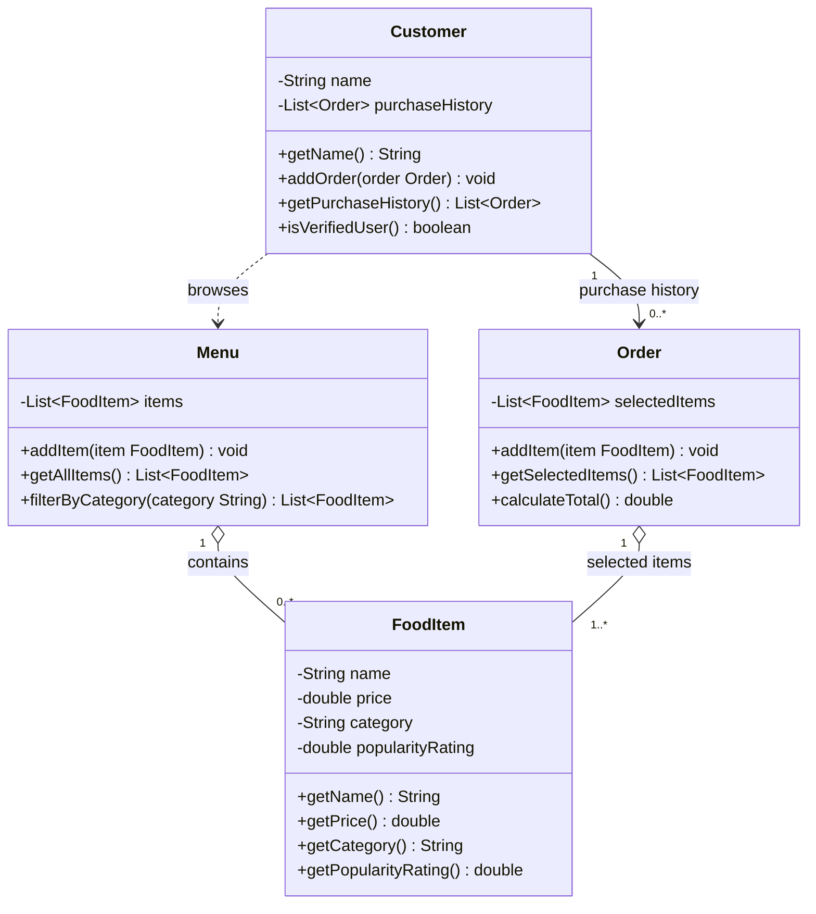

# ByteBites Class Diagram

## Classes and Responsibilities

| Class | Attributes | Responsibilities |
|---|---|---|
| **Customer** | `name`, `purchaseHistory` | Stores who the customer is and their past orders; confirms the customer is a real user. |
| **FoodItem** | `name`, `price`, `category`, `popularityRating` | Holds the data for one item we sell (e.g., "Spicy Burger", "Large Soda"). |
| **Menu** | `items` | Holds the full collection of food items and filters them by category (e.g., "Drinks", "Desserts"). |
| **Order** | `selectedItems` | Groups the items a user picks into one transaction and computes the total cost. |

## Relationships

- **Customer → Order (1 to 0..\*)**: a customer's purchase history is a list of their past orders. A new customer has none.
- **Menu ◇— FoodItem (1 to 0..\*)**: the menu contains food items (aggregation, since a `FoodItem` is a standalone object the menu only holds).
- **Order ◇— FoodItem (1 to 1..\*)**: an order stores the items the user selected. The same `FoodItem` can appear in many orders and on the menu.
- **Customer ⇢ Menu (dependency)**: customers browse the menu, but the menu doesn't need to be stored on the customer.

## Assumptions

1. **"Verify they are real users"**: the spec doesn't define verification. I assumed `isVerifiedUser()` returns true when the customer has a name and a purchase history, and you can change that rule later.
2. **Purchase history is a list of `Order` objects.** That reuses the four given classes instead of adding a separate "Purchase" or "Transaction" class.
3. **`Order` has no price field of its own.** It reads each `FoodItem`'s `price` when `calculateTotal()` runs. If menu prices may change after purchase, store the price at order time.
4. **Quantities aren't tracked.** Adding the same item twice means it appears twice in the list. The spec doesn't mention quantities.
5. **`category` is a plain `String`** such as "Drinks" or "Desserts". An enum or `Category` class would be overkill here.
6. **`popularityRating` is a number**, for example 1 to 5. The spec gives no scale.
7. **An order has at least one item** (`1..*`), since an empty transaction wouldn't make sense. Relax this to `0..*` if you want to build an order up gradually.
8. **No extra classes** (Payment, Cart, Restaurant, etc.) because the request doesn't call for them.
